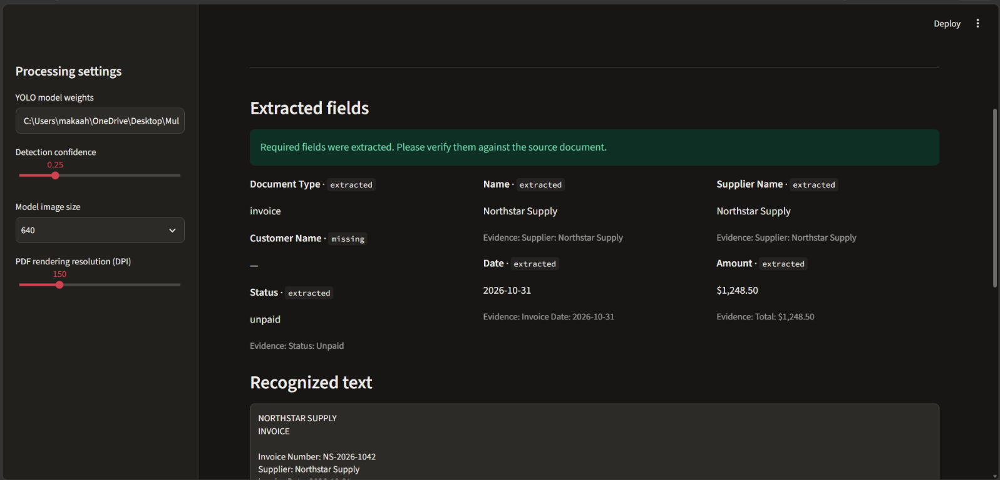
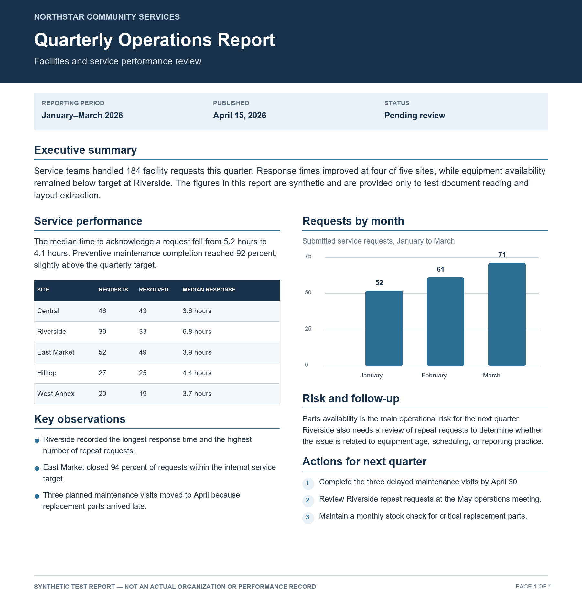

# Multimodal Document Intelligence

A local Streamlit app for extracting information from document images and PDFs. It combines a YOLO document-layout detector, pretrained Tesseract OCR, conservative field-extraction rules, schema validation, and evidence-based question answering. Uploaded documents are processed locally using the models and OCR engine installed on your computer.

## Demo

The short project walkthrough is in [`demo/document_intelligence_demo.mp4`](demo/document_intelligence_demo.mp4).

| App screenshot | Example input |
| --- | --- |
|  |  |

The example report is synthetic and contains no real organization or personal data.

More screenshots: [detected OCR regions](screenshots/02-detected-regions.png) and [structured JSON output](screenshots/03-structured-json.png).

## Features

- Upload JPG, JPEG, PNG, or PDF documents in the browser.
- Detect general document regions with the included YOLO weights and recognize text with Tesseract.
- Extract document type, names, date, amount, and status with rules, including evidence and `extracted` / `uncertain` / `missing` states.
- Validate result structure and required-field review status with Pydantic.
- Ask questions about known fields or retrieve content under a document section heading; answers show supporting OCR evidence.
- Download structured JSON and inspect recognized text and processing alternatives.

## Requirements

- Windows, macOS, or Linux
- Python 3.11+
- Tesseract OCR installed on the machine
- The included model file: `best_model/doclaynet_yolov8s_baseline.pt`

### Install Tesseract

Install Tesseract for your operating system and make sure its executable is available on `PATH`. On Windows, the common executable location is `C:\\Program Files\\Tesseract-OCR\\tesseract.exe`. If it is installed elsewhere, set `TESSERACT_CMD` to the full path before starting the app.

## Setup and run

From the project folder in PowerShell:

```powershell
py -3.11 -m venv .venv
.\.venv\Scripts\python.exe -m pip install --upgrade pip
.\.venv\Scripts\python.exe -m pip install -r requirements.txt
.\.venv\Scripts\python.exe -m streamlit run streamlit_app.py
```

Open the local URL printed by Streamlit, usually `http://localhost:8501`, then upload an image or PDF. The sidebar lets you select model weights and adjust detection confidence, image size, and PDF rendering DPI. Defaults are intended as a practical starting point, not universally optimal settings.

If Tesseract is not on `PATH`, set its path in PowerShell before launch:

```powershell
$env:TESSERACT_CMD = 'C:\Program Files\Tesseract-OCR\tesseract.exe'
.\.venv\Scripts\python.exe -m streamlit run streamlit_app.py
```

## Verify the sample evaluation

The repository includes synthetic sample documents and expected field labels. To regenerate the evaluation images and run the field-level evaluation:

```powershell
.\.venv\Scripts\python.exe samples/create_evaluation_samples.py
.\.venv\Scripts\python.exe evaluation/evaluate_samples.py
```

To run the unit tests:

```powershell
.\.venv\Scripts\python.exe -m unittest tests.test_app -v
```

Evaluation on generated documents is a functional check, not a representative real-world accuracy claim. See [`LIMITATIONS.md`](LIMITATIONS.md) for known risks and evaluation scope.

## Pipeline and model

1. The app accepts an image or renders PDF pages to images.
2. The included YOLO model predicts general document-layout regions. It was trained for document layout and was not fine-tuned here for invoices or receipts.
3. The app OCRs regions and the full page with Tesseract using the measured preprocessing configuration (2× upscale, 10 px margin, page segmentation mode 6), then selects/merges text for extraction.
4. Rule-based extraction produces field values with OCR evidence. Pydantic checks the output schema and marks missing or ambiguous required fields for review.
5. Question answering uses extracted values and OCR text/section evidence to retrieve grounded answers.

The current Q&A and field extraction are rule-based; they use evidence found in the document. Tesseract and the YOLO detector run locally. The YOLO checkpoint is included at `best_model/doclaynet_yolov8s_baseline.pt` so the app can run without downloading project weights.

## Repository contents

- `streamlit_app.py` — interactive web interface.
- `app.py` — image/PDF processing, layout detection, OCR, extraction, validation, and Q&A logic.
- `best_model/` — YOLO weights used by the app.
- `samples/` — synthetic example documents and generation scripts.
- `output_examples/` — example structured outputs.
- `evaluation/` and `tests/` — evaluation and tests.
- `demo/` — walkthrough video and its generation script.
- `multimodal-document-intelligence.ipynb` — Kaggle YOLO layout-detector training and evaluation workflow.
- `ocr-multimodal.ipynb` — Kaggle OCR engine/preprocessing comparison and structured-output experiment.
- `LIMITATIONS.md` — scope and known limitations.

The two notebooks are experiment records, not required to run the app. The YOLO notebook expects the DocLayNet Kaggle dataset attachment and can process/download a large dataset; review its setup cells and Kaggle input paths before running it.

## Limitations

- The layout model learned general document regions from DocLayNet-style data, not invoice- or receipt-specific layouts; the app's full-page OCR fallback helps but does not guarantee region coverage.
- Reading order is approximate for multi-column pages. Table content is OCRed as flattened text; row and cell relationships are not reconstructed.
- OCR may degrade on blur, skew, handwriting, unusual fonts/languages, or low contrast.
- The OCR comparison used 12 labeled crops. It is too small to establish broad accuracy claims.
- Extraction uses rules and can miss unfamiliar wording, currency formats, or document types. Check uncertain fields and evidence against the source.
- OCR confidence is not calibrated as field confidence, so the structured output leaves confidence unavailable (`null`).
- The Q&A feature retrieves matching fields and section text. It does not provide general reasoning or reliably answer questions that require combining facts across distant parts of a document.
- Synthetic examples are clean and may overstate performance on real documents. Evaluate with representative, appropriately licensed documents before deployment.

## Future work

- Evaluate an optional LLM-backed extraction and question-answering mode for varied wording and questions that need information combined across a document. Keep the current evidence-based pipeline as a baseline, require schema validation, and compare both approaches on the same labeled documents. Any hosted model option should clearly explain where document data is sent; a local model could be evaluated for privacy-sensitive use.
- Improve layout detection for invoices, receipts, and forms by collecting appropriately licensed, representative annotations and training or fine-tuning a document-specific YOLO model. Compare the current general layout checkpoint against the specialized model on a held-out set.
- Benchmark OCR engines and preprocessing settings on a larger labeled set, including difficult crops and document languages. Consider replacing or fine-tuning the OCR engine only if repeated errors show a clear benefit; report character and word error rates by document type.
- Add table-structure recognition and more reliable multi-column reading order so line items and their descriptions remain associated.
- Expand evaluation with diverse public or carefully permissioned documents, and track field-level accuracy, missing-versus-wrong values, review-flag recall, and processing time.

## License

No license has been specified yet. Until one is added, all rights remain with the respective copyright holders; check model and dependency licenses before redistribution or commercial use.
